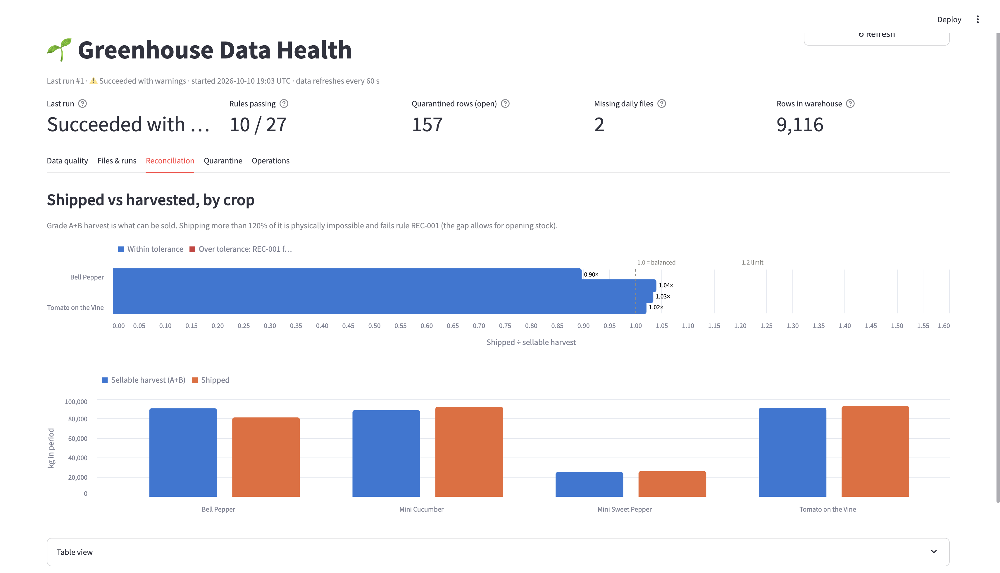

# Greenhouse Data Quality & Pipeline Health Monitor

A SQL Server data pipeline for greenhouse operations data. It loads three source systems
(climate sensors, ERP harvest records, warehouse shipments), runs data quality controls
from source to target, quarantines bad rows for triage, and reports data quality and
pipeline health on a dashboard.

The source data is synthetic and contains **19 deliberately planted data quality issues**
(see `data/planted_issues.json` after generating). The answer key lets you prove the
controls catch every one of them.

## Architecture

```
 Source files                 SQL Server: GreenhouseDW
 ─────────────                ───────────────────────────────────────────────────────────
 climate/*.csv     ─┐         ops.file_load      file audit: hash, row counts, status
 erp/*.csv         ─┼─ load ─▶ stg.*             raw landing, all text
 shipments/*.json  ─┘            │
                                 ▼ DQ rules (dq.check_rule)──▶ dq.result     metrics per run
                                 │                     ──▶ err.quarantine bad rows as JSON
                                 ▼
                              dw.dim_* / dw.fact_*  star schema  ──▶ dashboard (Streamlit)
```

| Schema | Purpose |
|---|---|
| `ref` | Master data and config: crops, zones, SKUs, valid sensor ranges, crop aliases |
| `stg` | Raw landing. Every column is text so a bad value never breaks a load |
| `dq`  | Rule catalogue and per-run results (rows checked, rows failed, failure rate) |
| `err` | Quarantined rows with the rule that caught them |
| `dw`  | Typed star schema for reporting |
| `ops` | Pipeline runs and file-level audit |

## Controls at each hop

**File → staging** (`pipeline/load_staging.py`)
- Idempotent: a file whose SHA-256 was already loaded is skipped, so reruns are safe
- Schema check: a file missing an expected column is rejected whole
- Row-count reconciliation: rows in file must equal rows landed

**Staging → warehouse** (`sql/05_dq_engine.sql`, rules in `sql/04_dq_rules.sql`)

27 rules live in `dq.check_rule` as data: dimension, severity, and what happens on failure.
A rule can be switched off with `is_active = 0`, no code change.

| Prefix | Source | Examples |
|---|---|---|
| `CLM` | Climate sensors | zone exists, one reading per hour, values in range, 24 readings per zone-day, flatlined sensor |
| `HRV` | ERP harvest | unique harvest ID, crop name in master, no future dates, grade valid, kg ≥ 0 |
| `SHP` | WMS shipments | unique line, SKU in master, cases > 0, customer present, missing or late files |
| `REC` | Cross-system | shipped kg per crop must not exceed sellable harvest by more than 20% |

- **Row rules** (`-0xx`) test every staging row. `Quarantine` rules keep the row out of the warehouse
  and copy it, as JSON, to `err.quarantine` with the rule that caught it. `Warn` rules let it load.
- **Set rules** (`-1xx`, `REC`) test a whole day, file set or table: missing files, incomplete days,
  stuck sensors (gaps-and-islands on CO₂), and harvest-vs-shipment reconciliation.
- Every rule writes rows checked / rows failed / failure rate to `dq.result` on every run.
- The whole DQ + load step runs in one transaction (`ops.usp_process_pending`): it either fully lands or not at all.
- Incremental: only files not yet processed are picked up.

**Proof the controls work**: `make verify` compares each rule's result with the generator's answer key.
Every planted issue must be caught with the exact expected row count, and every other rule must report zero.
Issues resolved by a master-data fix (H01, after RCA-001) are expected to pass instead, and are reported as resolved.

## Dashboard

`make dashboard`, then open http://localhost:8501. Five tabs, all read live from the database:

| Tab | Answers |
|---|---|
| **Data quality** | Which rules fail, by how much, per source; full rule scorecard; failing rules per run |
| **Files & runs** | Daily file arrival grid (missing days in red), file-level row reconciliation, run history |
| **Reconciliation** | Shipped vs sellable harvest per crop against the 20% tolerance (REC-001) |
| **Quarantine** | Rows held per rule, drill-down into the raw rows, CSV export for triage |
| **Operations** | Sellable yield per m² by zone: a zone far below its peers points to missing data |

Built with Streamlit + Altair because Power BI Desktop is Windows-only. Every query sits in
`dashboard/queries.py` against the `dq`/`err` views, so the same model plugs into Power BI
(SQL Server connector) unchanged.



## Root cause analysis

The first full run failed the reconciliation control: Bell Pepper shipped 42% more than was harvested.
Two clerks had entered the crop with non-standard spellings, so 36 harvest records (33,469 kg) were
quarantined and missing from reporting. The fix maps spellings in master data (`config/crop_aliases.csv`).
Full write-up: [RCA-001](docs/RCA-001-bell-pepper-reconciliation.md).

To replay the incident, delete the two alias rows from `config/crop_aliases.csv` and run `make all`:
REC-001 fails again and Bell Pepper shows 1.42× on the dashboard. Restore the rows and rerun to see the fix.

## Running it

The only prerequisite is **Docker Desktop**. SQL Server and the Python pipeline
(with the Microsoft ODBC driver) both run in containers, so it behaves the same on
Mac, Windows and Linux.

```bash
cp .env.example .env     # then change the password
make build               # build the Python image (first time only)
make all                 # generate data -> build database -> run pipeline -> verify
```

| Command | What it does |
|---|---|
| `make up` | Start SQL Server and wait until it is healthy |
| `make generate` | Create the synthetic source files in `data/` |
| `make setup` | Rebuild the database (drops and recreates tables) |
| `make load` | Land source files in `stg.*` only |
| `make run` | Full pipeline: files → staging → DQ rules → warehouse + quarantine |
| `make verify` | Compare DQ results with the planted-issues answer key |
| `make dashboard` | Start the dashboard on http://localhost:8501 |
| `make test` | Render the dashboard with sample data (no database needed) |
| `make sql` | Open a SQL prompt on GreenhouseDW |
| `make down` / `make reset` | Stop SQL Server / delete it and its data |

Run `make run` a second time: every file shows as `skipped` and nothing is double-loaded.
That is the idempotency control working.

Useful views: `dq.vw_rule_results`, `dq.vw_latest_rule_status`, `dq.vw_crop_reconciliation`,
`err.vw_quarantine_summary`.

Apple Silicon Macs: in Docker Desktop, turn on "Use Rosetta for x86_64/amd64 emulation" so the SQL Server image runs.

To browse the database from a GUI, connect VS Code (SQL Server extension) or any SQL client to
`localhost,1433`, user `sa`, with "Trust server certificate" enabled.

## Source data

| Source | Format | Volume | Notes |
|---|---|---|---|
| Climate sensors | CSV, one file per day | ~8,400 hourly readings, 12 zones | temp, humidity, CO₂, light |
| ERP harvest export | CSV, one monthly file | ~500 records | zone, crop, grade, kg |
| WMS shipments | Nested JSON, one file per day | ~360 lines | flattened to one row per line |

Shipments start from about two days of opening stock, so shipped kg can run slightly above
harvested kg for a crop. A gap of 40%+ is not normal. That is the RCA.

## Project structure

```
Dockerfile                   Python 3.12 + ODBC Driver 18 image for the pipeline
docker-compose.yml           SQL Server + pipeline containers
Makefile                     one-word commands for every step
generator/generate_data.py   synthetic data + planted issues
pipeline/db.py               connection + SQL file runner
pipeline/setup_db.py         build the database
pipeline/load_staging.py     file → staging loader with controls
pipeline/run_pipeline.py     full run: load → DQ → warehouse, with a summary
pipeline/verify_planted.py   checks DQ results against the answer key
config/crop_aliases.csv      maintained crop-name spellings (master data fix)
dashboard/app.py             data health dashboard (Streamlit + Altair)
dashboard/queries.py         every query the dashboard runs
tests/smoke_dashboard.py     renders the dashboard with sample data
docs/                        RCA write-up and documentation
sql/01_schemas.sql           schemas
sql/02_tables.sql            all tables
sql/03_seed_config.sql       sensor ranges + date dimension
sql/04_dq_rules.sql          the 27-rule catalogue
sql/05_dq_engine.sql         DQ engine, warehouse load, views
```

## Progress

- [x] Data generator with planted issues
- [x] Database schema (ref / stg / dq / err / dw / ops)
- [x] Staging loader with file-level controls
- [x] DQ rule catalogue + quarantine
- [x] Staging → warehouse transforms
- [x] Answer-key verification
- [x] Root cause analysis write-up
- [ ] Indexing and tuning (before/after)
- [ ] Backup and restore test
- [ ] Source-to-Target Mapping, data dictionary (AI-assisted), runbook
- [x] Data health dashboard
